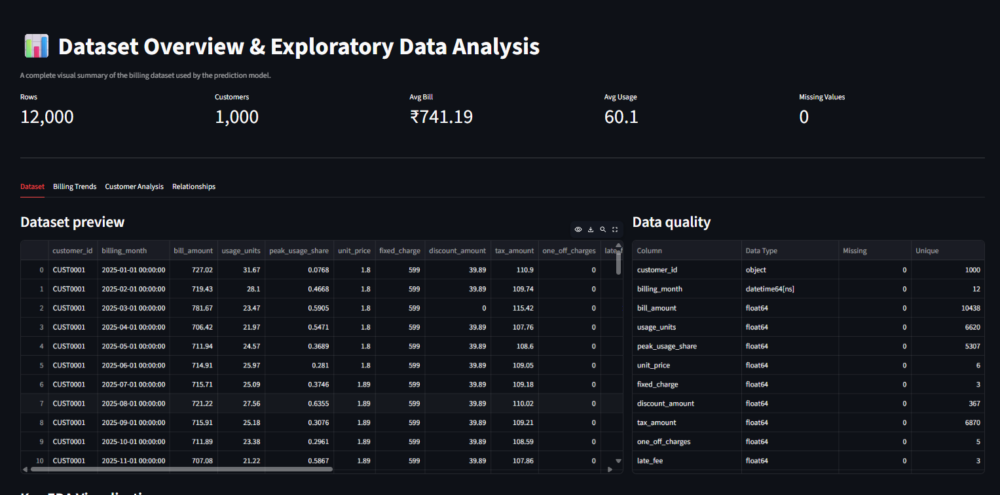
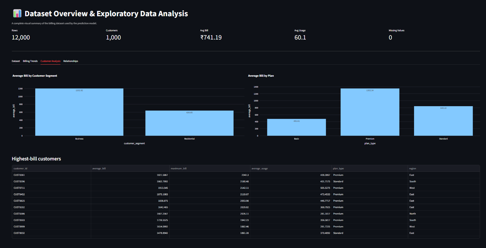
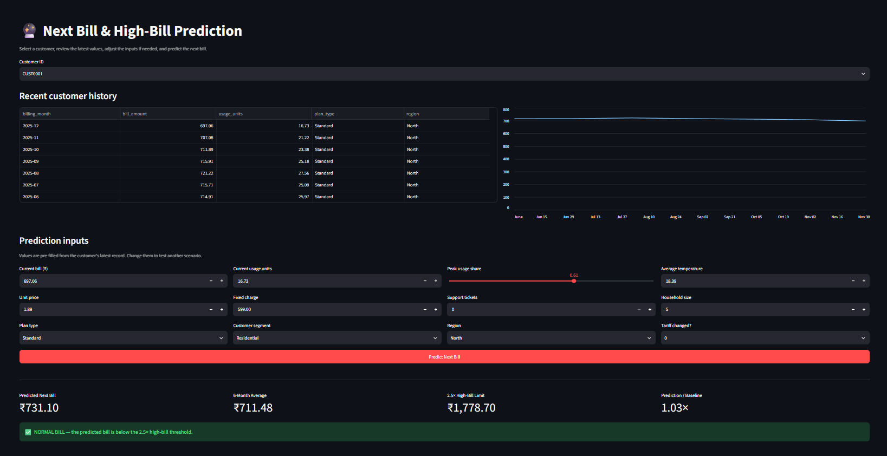

# ⚡ Next Bill Prediction & High-Bill Detection

An end-to-end machine learning project that analyzes customer billing behavior, predicts the next bill amount from historical information, and flags potential bill shock using a **2.5× six-month historical baseline**. The final model is served through a simple two-page **Streamlit dashboard**.

## 🎯 Objective

The project solves four practical problems:

1. Explore billing, usage, plans, customer segments, and data quality.
2. Engineer leakage-safe historical features from monthly customer records.
3. Compare multiple regression models and save the strongest model.
4. Let a user interactively predict the next bill and determine whether it is unusually high.

## 🏗️ Project Architecture

```text
next_bill_prediction_github/
│
├── app.py                         # Two-page Streamlit application
├── README.md                      # Project documentation
├── requirements.txt               # Python dependencies
├── .gitignore
│
├── data/
│   └── billings.csv               # Single source dataset
│
├── models/
│   └── best_model.joblib          # Saved best prediction model
│
├── notebooks/
│   └── model_training.ipynb       # EDA, features, training and evaluation
│
└── assets/
    ├── dataset_overview.png
    ├── customer_analysis.png
    └── bill_prediction.png
```

## 🔄 End-to-End Workflow

```text
Billing CSV
    │
    ▼
Data Loading & Quality Checks
    │
    ▼
Exploratory Data Analysis
    │
    ▼
Chronological Customer History
    │
    ▼
Feature Engineering
    ├── Bill lags
    ├── Usage lags
    ├── 3-month rolling statistics
    ├── 6-month rolling statistics
    ├── Seasonality
    └── Customer-history ratios
    │
    ▼
Chronological Train / Test Split
    │
    ▼
Model Comparison
    ├── Linear Regression
    ├── Random Forest
    ├── XGBoost
    └── LightGBM
    │
    ▼
Best Model Selection
    │
    ▼
Model Saved as Joblib
    │
    ▼
Streamlit Dashboard
    ├── Dataset & EDA
    └── Next Bill Prediction
             │
             ▼
      2.5× High-Bill Rule
```

## 📊 Dataset

The included dataset contains **12,000 monthly billing records for 1,000 customers**. Important fields include bill amount, usage, peak usage share, unit price, fixed charge, plan type, customer segment, region, household size, temperature, support tickets, tariff-change information, and billing month.

The dashboard also reports missing values, column types, unique values, and raw record previews.

## 🔍 Step 1 — Exploratory Data Analysis

The EDA focuses on the most useful business and modeling questions:

- How bills change over time
- Distribution of customer bill amounts
- Relationship between usage and bill amount
- Differences across plan types
- Differences across customer segments
- Region-level behavior
- Highest-bill customers
- Temperature vs usage
- Correlation between numerical variables
- Data completeness and uniqueness

### Dataset Overview



### Customer Analysis



## 🧠 Step 2 — Feature Engineering

Historical features are generated from each customer's monthly records. The main engineered variables include:

```text
bill_lag_1, bill_lag_2, bill_lag_3, bill_lag_6
usage_lag_1, usage_lag_2, usage_lag_3, usage_lag_6
bill_roll_mean_3, bill_roll_mean_6
bill_roll_std_3, bill_roll_std_6
usage_roll_mean_3, usage_roll_mean_6
usage_roll_std_3, usage_roll_std_6
bill_vs_roll6, usage_vs_roll6
month, sin_month, cos_month, tenure_months
```

Rolling and lag features allow the model to learn recent billing behavior without relying on future information.

## ⏳ Step 3 — Chronological Validation

This is a forecasting problem, so records are kept in time order. Earlier periods are used for training and later periods are used for evaluation instead of randomly mixing future and historical observations.

```text
Past customer history → Model training → Future period → Evaluation
```

This makes the reported model performance much closer to the real deployment scenario.

## 🤖 Step 4 — Model Training

Four regression models are compared in the notebook:

- Linear Regression
- Random Forest Regressor
- XGBoost Regressor
- LightGBM Regressor

The comparison uses common forecasting/regression metrics:

- **MAE** — average absolute prediction error
- **RMSE** — penalizes larger prediction errors
- **WAPE** — total absolute error relative to total actual billing
- **R²** — proportion of target variation explained by the model

The selected model is saved as:

```text
models/best_model.joblib
```

The Streamlit application loads this model directly, so it does not retrain every time the app starts.

## 🚨 Step 5 — High-Bill Detection

After predicting the next bill, the system calculates the customer's recent six-month average.

```text
High-Bill Threshold = 2.5 × Six-Month Average Bill
```

Decision rule:

```text
Predicted next bill > 2.5 × six-month average  →  HIGH BILL
Predicted next bill ≤ 2.5 × six-month average  →  NORMAL BILL
```

The business threshold is deliberately simple so the prediction can be interpreted immediately.

## 🖥️ Streamlit Dashboard

The application has only **two pages**, keeping the deployment simple and focused.

### 1. 📊 Dataset & EDA

This page contains:

- Dataset KPIs
- Dataset preview
- Data-quality table
- Monthly bill trends
- Bill distribution
- Average bill by plan type
- Usage vs bill amount
- Customer segment analysis
- Highest-bill customers
- Relationship plots
- Correlation heatmap

### 2. 🔮 Bill Prediction

The prediction page:

1. Selects a customer.
2. Loads recent billing history from the CSV.
3. Pre-fills the latest values.
4. Allows the user to modify the scenario.
5. Recreates the required lag and rolling features.
6. Runs the saved model.
7. Displays the predicted next bill.
8. Compares it with the six-month baseline.
9. Calculates the 2.5× high-bill threshold.
10. Returns **NORMAL BILL** or **HIGH BILL ALERT**.



## 🧾 Prediction Inputs

The dashboard accepts or derives inputs such as:

- Current bill
- Current usage units
- Peak usage share
- Unit price
- Fixed charge
- Average temperature
- Support tickets
- Household size
- Plan type
- Customer segment
- Region
- Tariff-change indicator
- Historical bill and usage lags
- Rolling bill and usage statistics

## 🛠️ Tech Stack

| Area | Tools |
|---|---|
| Data manipulation | Python, Pandas, NumPy |
| Machine learning | Scikit-learn, XGBoost, LightGBM |
| Visualization | Plotly |
| Model persistence | Joblib |
| App | Streamlit |
| Notebook | Jupyter |

## 🚀 Run Locally

### 1. Clone the repository

```bash
git clone https://github.com/YOUR_USERNAME/YOUR_REPOSITORY.git
cd YOUR_REPOSITORY
```

### 2. Create a virtual environment (recommended)

```bash
python -m venv venv
```

Activate it on Windows:

```bash
venv\Scripts\activate
```

Activate it on macOS/Linux:

```bash
source venv/bin/activate
```

### 3. Install dependencies

```bash
pip install -r requirements.txt
```

### 4. Run Streamlit

```bash
streamlit run app.py
```

Then open the local Streamlit URL shown in the terminal, usually:

```text
http://localhost:8501
```

## 📓 Retrain the Model

Open:

```text
notebooks/model_training.ipynb
```

and run the cells in order. The notebook contains the complete modeling workflow from EDA to final model saving.

## 🔐 Leakage Prevention

To make the forecasting result defensible:

- Customer observations are ordered chronologically.
- Historical lag/rolling variables are used for future prediction.
- The held-out period comes after the training period.
- The final app reconstructs features only from information available in the customer's history and user inputs.

## 💡 Key Project Value

This project demonstrates an end-to-end data science workflow rather than only a model notebook:

```text
Data → EDA → Feature Engineering → ML → Evaluation → Saved Model → Interactive App
```

The result is a practical prototype that can help identify potential bill shock early and provide an understandable customer-level forecast.

## 🔮 Future Improvements

Potential extensions include:

- SHAP-based local prediction explanations
- Prediction intervals and uncertainty
- Real-time API serving with FastAPI
- Automated retraining
- Cloud deployment
- Customer alert notifications
- More historical months and external weather data
- Dedicated anomaly-scoring model

## ▶️ Quick Start

```bash
pip install -r requirements.txt
streamlit run app.py
```

---

**Built as an end-to-end next-bill forecasting and bill-shock detection project using machine learning and Streamlit.**
